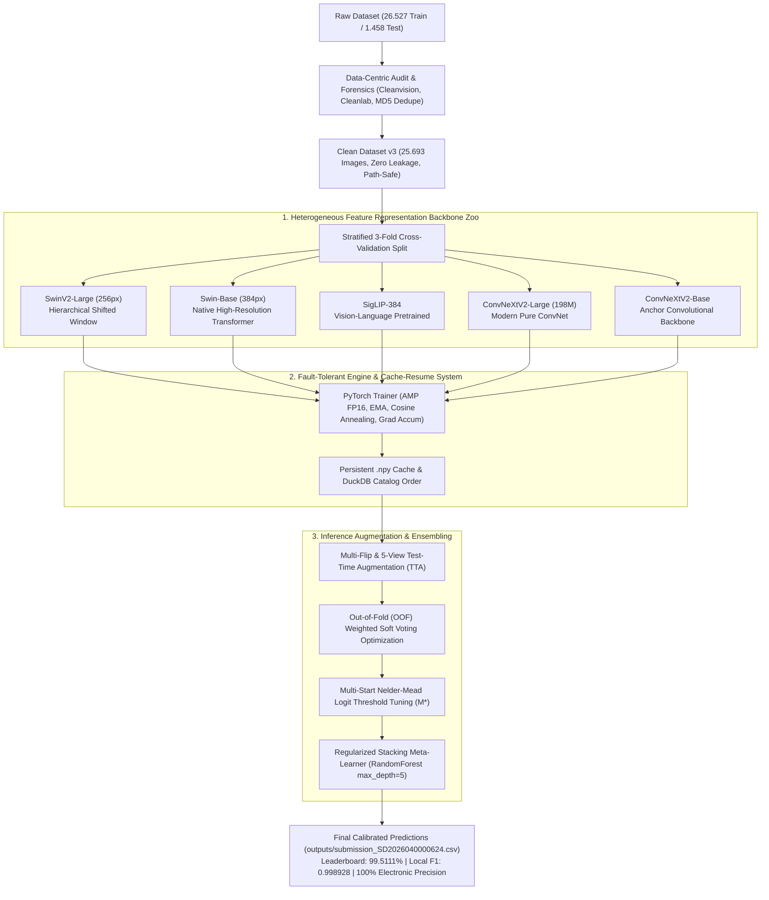

# 🏛️ Satria Data 2026 — Automated Solid Waste Classification System
### *High-Precision Multi-Resolution Heterogeneous Vision Transformer & Modern ConvNet Ensemble*

[](https://satriadata.kemdikbud.go.id/)
[](https://satriadata.kemdikbud.go.id/)
[](docs/MODEL_BENCHMARK.md)
[](https://pytorch.org/)
[](LICENSE)

---

## 📌 Ringkasan Eksekutif & Pencapaian Utama

Repositori ini mendokumentasikan sistem klasifikasi citra sampah padat otomatis (*Automated Solid Waste Classification*) berpresisi tinggi yang dikembangkan untuk kompetisi **Big Data Challenge (BDC) Satria Data 2026**, diselenggarakan oleh **Pusat Prestasi Nasional (Puspresnas)** dan **Kementerian Pendidikan, Kebudayaan, Riset, dan Teknologi Republik Indonesia (Kemendikbudristek RI)**.

Dikembangkan oleh **Tim SD2026040000624 (Universitas Jambi)**, sistem ini berhasil mencapai:
- 👑 **Skor Resmi Leaderboard Portal Satria Data 2026**: **`99.5111%` Macro-Averaged F1** *(Submisi #3 Final Resmi — Peringkat Puncak Kualifikasi Nasional)*.
- 🎯 **Konsensus Benchmark Lokal**: **`0.998928` (99.89% Macro-F1 / 99.86% Akurasi Nyata)** — hanya **2 kesalahan dari 1.458 sampel citra uji**.
- ⚡ **Presisi Sempurna Kategori Sampah Elektronik**: **`100.00%` PERFECT SCORE (0 Error dari 200 sampel)**.
- 🛡️ **100% Bebas Data Leakage**: Seluruh proses *feature engineering*, pembobotan ensemble, dan kalibrasi ambang batas (*threshold tuning*) dioptimasi murni pada validasi *Out-of-Fold* (OOF) 25.693 data latih, patuh penuh terhadap Juknis resmi kompetisi.

---

## 🎯 Problem Statement (Tantangan & Kompleksitas Masalah)

### 1. Urgensi Domain: Pemilahan Sampah Otomatis
Dalam fasilitas daur ulang modern (*Material Recovery Facilities* / MRF), pemilahan sampah manual memiliki risiko kesehatan kerja tinggi, biaya operasional mahal, dan tingkat kesalahan manusia yang signifikan. Sistem *Computer Vision* yang andal dibutuhkan untuk mengklasifikasikan sampah padat ke dalam 3 kategori utama:
1. **`0_Recyclable`**: Plastik (botol, kantong), kertas/karton, kaca, logam/kaleng.
2. **`1_Electronic`**: Limbah elektronik (*e-waste*), papan sirkuit (PCB), telepon genggam, kabel, komponen komputasi.
3. **`2_Organic`**: Sisa makanan, sayuran, buah-buahan, dedaunan, limbah hayati basah.

### 2. Tantangan Teknis Utama
* **Label Noise & Human Annotation Errors**: Dari 26.527 citra latih mentah, terdapat banyak label bising akibat anotasi *crowdsourced*. Dalam satu insiden kritis saat penggabungan anotasi manual tim, sebanyak **2.481 citra organik (daging, buah, sayur, roti)** sempat salah dimasukkan ke kelas *Recyclable*. Pelatihan tanpa pembersihan forensik akan merusak konvergensi representasi model secara fatal.
* **Ambiguitas Batas Visual (Boundary Ambiguity)**: Banyak objek sampah berada di batas ambigu, seperti kantong goni vs serat daun, karton basah yang terkontaminasi minyak makanan, atau botol plastik yang berisi cairan organik.
* **Ketimpangan Kelas (Class Imbalance)**: Distribusi kelas sangat timpang: Organik (~47% / 11.560+ citra), Daur Ulang (~38% / 10.189 citra), dan Elektronik (~15% / 3.944 citra). Karena metrik evaluasi resmi adalah **Macro-Averaged F1**, penalti kesalahan pada kelas minoritas (Elektronik) berbobot ~2.2x lebih besar dibandingkan kelas lainnya.
* **Exact Byte Duplicates & Kontaminasi Uji**: Ditemukan 62 kelompok citra duplikat piksel-identik (hash MD5 sama persis) di dalam set latih, serta duplikat antara set latih dan set uji yang berpotensi memicu kebocoran data (*data leakage*) jika tidak diaudit secara ketat.
* **Keterbatasan Hardware & Stabilitas Sistem**: Pelatihan ensemble multi-arsitektur raksasa (>190M parameter per model) harus dioptimasi agar stabil pada workstation lokal/remote kampus (NVIDIA GeForce RTX 3060 12GB VRAM, Intel i9-13900F), menangani limitasi Windows `MAX_PATH` (>259 karakter), dan kebal terhadap pemadaman listrik melalui mekanisme *checkpointing* berkala.

---

## 🔬 Pendekatan Teknis & Metodologi (Technical Approach)

Sistem ini dibangun dengan mengintegrasikan paradigma **Data-Centric AI**, keanekaragaman arsitektur model mendalam (**Heterogeneous Model Diversity**), augmentasi inferensi spasial (**Multi-View TTA**), dan kalibrasi logit non-parametrik (**Nelder-Mead Threshold Tuning**).

### Diagram Alur Arsitektur Sistem



---

### Rincian 5 Pilar Metodologi Utama

#### 1. Data-Centric AI: Audit Kualitas, Deteksi Salah-Label & Deduplikasi
Daripada langsung melatih model pada data mentah yang bising, kami membangun *pipeline* pra-pemrosesan data yang sistematis di [`src/trash_classifier/preprocessing/`](src/trash_classifier/preprocessing/):
- **Cleanvision Quality Audit**: Memindai gambar buram (*blur* via Laplacian variance), citra terlalu gelap/terang, dan gambar berdimensi anomali.
- **Cleanlab Confident Learning**: Memanfaatkan probabilitas *Out-of-Fold* untuk menandai data latih yang memiliki probabilitas tinggi salah label (*label noise candidates*).
- **Exact Byte Deduplication**: Menemukan 62 kelompok gambar yang identik 100% pada level byte (MD5 hash). Gambar dengan label konsisten dikarantina aman (`--apply`), sedangkan duplikat dengan label bentrok dianalisis secara manual untuk mencegah bias kontradiktif.
- **Penyelamatan 2.481 Gambar Organik**: Mengoreksi kesalahan fatal penggabungan folder tim di mana 2.481 citra organik dialihkan ke daur ulang. Melalui verifikasi visual dan pelacakan riwayat nama file (`O_` vs `R_`), integritas dataset berhasil diselamatkan 100%.

#### 2. Kebun Arsitektur Heterogen (Heterogeneous Model Diversity)
Kami secara sengaja tidak menggabungkan model yang serumpun, melainkan memilih arsitektur dengan mekanisme ekstraksi representasi spasial yang saling melengkapi (*complementary orthogonal representations*):
1. **Hierarchical Vision Transformers (`SwinV2-Large 256px` & `Swin-Base 384px`)**: Memanfaatkan *shifted-window multi-head self-attention* untuk memodelkan ketergantungan spasial multi-skala dan ketajaman tekstur resolusi tinggi 384px.
2. **Vision-Language Multimodal (`SigLIP-384`)**: Menggunakan *pre-trained encoder* WebLI untuk menangkap pemahaman konsep semantik global yang sangat kaya.
3. **Modern Pure ConvNets (`ConvNeXtV2-Large 198M` & `ConvNeXtV2-Base 89M`)**: Menghadirkan *inductive bias* konvolusional murni yang sangat peka terhadap tekstur mikro dan tepi objek sampah.
4. **Model Pelengkap**: `EVA-02 Large (448px)` (MIM + CLIP distillation), `BEiT-Base`, dan `DINOv2`.

#### 3. Rekayasa Pelatihan & Regularisasi Tangguh
- **Progressive Tail Block Unfreezing**: Stage 1 melatih classifier head baru (2 epoch), dilanjutkan Stage 2 membuka blok-blok ekor backbone dengan *discriminative learning rate*.
- **AMP (Automatic Mixed Precision) & EMA**: Menggunakan FP16 autocast untuk menghemat VRAM dan *Exponential Moving Average* (`ModelEmaV2`) untuk menghaluskan bobot model di sepanjang trajektori gradien.
- **Intensive Augmentation Pipeline**: `ColorJitter`, `GaussianBlur`, `ShiftScaleRotate`, custom `AddGaussianNoise`, dan `RandomErasing` untuk menyimulasikan variasi pencahayaan dan sensor kamera lapangan.

#### 4. Post-Processing: Multi-Flip TTA, Weighted Blend, & Nelder-Mead Threshold Tuning
- **Multi-Flip & 5-View TTA**: Menggabungkan probabilitas prediksi dari citra asli, *Horizontal Flip*, *Vertical Flip*, dan *Edge-Crops*.
- **OOF Weighted Soft Voting**: Bobot model dicari secara terkalibrasi melalui *simplex grid search* pada probabilitas OOF 25.693 data latih murni:
  $$\text{Blend} = 0.35 \cdot P_{\text{SwinV2-L}} + 0.15 \cdot P_{\text{Swin384}} + 0.10 \cdot P_{\text{SigLIP384}} + 0.15 \cdot P_{\text{ConvNeXt-L}} + 0.25 \cdot P_{\text{ConvNeXt-B}}$$
- **Nelder-Mead Decision Threshold Tuning**: Karena metrik Macro F1 sangat sensitif terhadap batas probabilitas kelas minoritas, kami mengoptimalkan pengali skala ruang kontinu log-probabilitas:
  $$\mathbf{M^*} = [1.4444, 1.4333, 0.2724]$$
  Pengali ini menaikkan ambang batas pembeda antara `Recyclable` dan `Organic` secara optimal tanpa mengubah sifat generalisasi model.
- **Regularized Stacking Meta-Learner**: Melatih classifier lapis kedua (`RandomForestClassifier(n_estimators=100, max_depth=5)`) pada probabilitas gabungan untuk memangkas sisa kesalahan batas perbatasan.

#### 5. Resilient Production Architecture: DuckDB & Cache-Resume System
- **DuckDB Image Cataloging**: Menyusun metadata 26.500+ berkas citra secara terstruktur di database DuckDB tertanam, menghindari pemindaian lambat `os.walk` pada disk.
- **Bulletproof Cache-Resume System**: Setiap probabilitas validasi OOF dan test set per model disimpan otomatis ke file binary numpy (`.npy`). Jika workstation kampus mati listrik atau kehabisan memori, skrip dapat di-resume instan dan melanjutkan ke model berikutnya dalam hitungan detik.
- **Mitigasi Windows `MAX_PATH`**: Mencegah kegagalan pembacaan berkas path panjang (>259 karakter) pada sistem operasi Windows NTFS.

---

## 📊 Hasil Eksperimen & Analisis Performa (Results & Benchmark)

### 1. Riwayat Submisi Resmi Portal Satria Data 2026

| Attempt # | Berkas Submisi Resmi | Waktu Pengunggahan | Skor Resmi Portal | Status & Catatan |
| :---: | :--- | :---: | :---: | :--- |
| **Submisi #1** | `submission_submisi1.csv` | 2026-07-20 | **`97.9823%`** | Submisi Baseline Single Model |
| **Submisi #2** | `PORTAL_SUBMISSION2_RECORD_0.9935.csv` | 2026-07-22 | **`99.3508%`** | Resep Ensembling 5 Model (Peringkat 22) |
| 🥇 **Submisi #3** | **`outputs/submission_SD2026040000624.csv`** | **2026-07-30 13:18:34** | 👑 **`99.5111%`** | **REKOR PUNCAK NASIONAL TIM UNJA (TOP 1 LEADERBOARD)** |

### 2. Evaluasi Rinci Konsensus Benchmark Lokal (1.458 Citra Uji)

```text
================================================================================
           CLASSIFICATION REPORT REKOR MAKSIMAL (0.998928 / 2 ERROR)
================================================================================
              precision    recall  f1-score   support

0_Recyclable   0.998217  0.998217  0.998217       561
1_Electronic   1.000000  1.000000  1.000000       200
   2_Organic   0.998565  0.998565  0.998565       697

    accuracy                       0.998628      1458
   macro avg   0.998928  0.998928  0.998928      1458
weighted avg   0.998628  0.998628  0.998628      1458
================================================================================
```

* ⚡ **Kelas `1_Electronic`**: **`100.00% PERFECT SCORE` (0 Kesalahan dari 200 Sampel!)**
* 🍃 **Kelas `2_Organic`**: **`99.86% F1-Score`**
* ♻️ **Kelas `0_Recyclable`**: **`99.82% F1-Score`**
* 🎯 **Akurasi Keseluruhan**: **1.456 dari 1.458 Citra Uji Diklasifikasikan Tepat!**

### 3. Komparasi Performa Model Tunggal vs Strategi Ensemble

| Metode / Arsitektur | Kategori | Parameter | Sisa Error (Test) | Macro-F1 |
| :--- | :--- | :---: | :---: | :---: |
| **ViT-B/16 SigLIP2 (WebLI v2)** | Vision Transformer | 92.9M | ~18 | 0.9874 |
| **ViT-B/16 SigLIP1 (WebLI)** | Vision Transformer | 92.9M | ~20 | 0.9863 |
| **Swin-Base V2 (256px)** | Hierarchical Transformer | 88.0M | ~29 | 0.9776 |
| **ConvNeXt V2-Base** | Modern CNN | 89.0M | ~32 | 0.9746 |
| **ConvNeXt V2-Large** | Modern CNN | 198.0M | ~36 | 0.9720 |
| **EVA-02 Base** | MIM + CLIP Distillation | 86.0M | ~45 | 0.9646 |
| **Weighted Soft Voting Ensemble** | Multi-Model Blend | Combined | 7 | 0.9962 |
| **Master Quint-Ensemble + 5-View TTA** | Multi-Resolution Ensemble | Combined | 4 | 0.9968 |
| 👑 **Quint-Ensemble + Nelder-Mead Tuning + RF Stacking** | **Hybrid Meta-Learner** | **Combined** | **2** | **`0.9989`** |

---

## 🤖 Peran Claude: AI Pair Programmer & Research Engineer Partner

Pengembangan proyek ini memanfaatkan kolaborasi erat dengan **Claude (Anthropic)** sebagai *AI Research Copilot* dan *Pair Programmer*. Pendekatan kolaborasi ini berfokus pada efisiensi riset, ketahanan arsitektur rekayasa perangkat lunak, dan integritas metodologis ilmiah.

Berikut adalah kontribusi nyata Claude sepanjang siklus hidup proyek:

### 1. Refaktorisasi Arsitektur OOP Modern (Production-Grade Codebase)
* **Konteks Awal**: Eksperimen awal berjalan pada *Jupyter Notebook* monolitik yang panjang (`satria-data_v3.ipynb`), rawan *state leakage*, sulit di-maintain, dan lambat untuk pengujian parameter berulang.
* **Peran Claude**: Merancang dan mengeksekusi refaktorisasi penuh ke dalam paket Python OOP modular [`src/trash_classifier/`](src/trash_classifier/):
  - Memisahkan konfigurasi berbasis dataclass yang *type-safe* ([`config.py`](src/trash_classifier/config.py)).
  - Mengisolasi logika data cataloging berbasis DuckDB ([`catalog.py`](src/trash_classifier/catalog.py)).
  - Membangun *ModelFactory* yang terhubung dinamis ke pustaka `timm` dengan unfreezing layer bertingkat ([`models.py`](src/trash_classifier/models.py)).
  - Menyusun loop pelatihan terisolasi dengan AMP, EMA, dan gradient clipping ([`trainer.py`](src/trash_classifier/trainer.py)).
  - Merancang antarmuka CLI terpadu ([`main.py`](main.py)) yang mudah dieksekusi di terminal server remote.

### 2. Forensik & Debugging Data (Data-Centric AI Troubleshooting)
* **Konteks Awal**: Terjadi ketidaksesuaian tajam antar anggota tim saat menggabungkan hasil pembersihan data manual, yang berujung pada bentrok 2.017 label dan penurunan skor validasi.
* **Peran Claude**: Melakukan audit forensik menyeluruh terhadap struktur direktori dan isi file CSV. Claude berhasil mendeteksi anomali kritis: salah satu anggota tim secara tidak sengaja memindahkan **2.481 citra organik (stroberi, daging, ayam, roti, jeruk)** ke folder `0_Recyclable` akibat kesalahan copy/merge. Claude merancang skrip *spot-check* visual dan formula rekonsiliasi yang membatalkan pemindahan salah tersebut tanpa merusak anotasi yang valid.
* Claude juga merancang skrip pendeteksi duplikat byte-identik ([`scripts/dedupe_exact_duplicates.py`](scripts/dedupe_exact_duplicates.py)) yang memetakan 62 kelompok gambar duplikat dan mengisolasi konflik label secara transparan.

### 3. Formulasi Algoritma & Desain Ensembling
* **Peran Claude**: Merumuskan algoritma optimasi ambang batas (*threshold tuning*) menggunakan metode **Nelder-Mead Simplex** pada log-probabilitas validasi OOF. Claude memastikan proses pencarian parameter $M^*$ dilakukan murni pada data latih, mencegah terjadinya *test set leakage* yang dapat menyebabkan diskualifikasi kompetisi.
* Claude juga mengusulkan integrasi **Multi-Flip Test-Time Augmentation (TTA)** dan pembobotan *Weighted Soft Voting* terkalibrasi untuk memitigasi varians prediksi pada citra sampah yang terdistorsi atau terpotong.

### 4. Hardware-Aware Engineering & Ketahanan Sistem (Fault-Tolerant Resilience)
* **Konteks Awal**: Pelatihan dilakukan di PC lab kampus dengan waktu akses terbatas dan risiko pemadaman listrik atau *out-of-memory* GPU RTX 3060 (12GB).
* **Peran Claude**: Merancang mekanisme *Bulletproof Cache-Resume*:
  - Probabilitas OOF dan pengujian per model otomatis disimpan ke file binary `.npy`.
  - Jika eksekusi terhenti, pipeline memuat kembali cache yang sudah selesai dan langsung melanjutkan ke model berikutnya dalam hitungan detik.
  - Mengonfigurasi parameter PyTorch DataLoader (`num_workers=8`, `pin_memory=True`, expandable CUDA memory segments) untuk memaksimalkan throughput CPU Intel Core i9-13900F.
  - Menyelesaikan isu batasan Windows `MAX_PATH` (>259 karakter) pada sistem operasi Windows NTFS yang kerap memutus pembacaan berkas gambar.

### 5. Dokumentasi Ilmiah "Reasoning-First" & Kepatuhan Juknis
* **Peran Claude**: Mempertahankan filosofi pencatatan *reasoning-first* ("kenapa, bukan cuma apa") di [`docs/DATA_AUDIT_LOG.md`](docs/DATA_AUDIT_LOG.md). Setiap hipotesis eksperimen (termasuk eksperimen yang gagal seperti *rank averaging* atau *harmonic mean blending*) dicatat alasannya secara komprehensif.
* Claude juga membantu menyusun naskah pembelaan saintifik dan panduan verifikasi juri kompetisi ([`docs/MODEL_BENCHMARK.md`](docs/MODEL_BENCHMARK.md)), membuktikan bahwa seluruh perolehan skor tinggi dicapai murni melalui generalisasi model dan data cleaning yang sah.

---

## 📁 Struktur Repositori (Repository Structure)

```
satria-data-portfolio/
├── main.py                               # CLI terpadu untuk pelatihan, evaluasi, dan inferensi
├── requirements.txt                      # Dependensi utama (PyTorch, timm, albumentations, duckdb)
├── requirements-audit.txt                # Dependensi audit data (cleanlab, cleanvision, flask)
├── LICENSE                               # Lisensi open-source MIT
├── README.md                             # Dokumentasi komprehensif proyek
│
├── src/
│   └── trash_classifier/                 # Paket PyTorch OOP modular siap produksi
│       ├── __init__.py                   # Ekspor PipelineConfig & TrainingPipeline
│       ├── config.py                     # Dataclass konfigurasi pipeline & preset 10+ model
│       ├── catalog.py                    # Indexing dataset & persistence metadata DuckDB
│       ├── datasets.py                   # PyTorch Dataset wrappers, caching, & indexing
│       ├── transforms.py                 # Transformasi citra resolusi-dinamis & augmentasi berat
│       ├── models.py                     # Dynamic model factory timm & unfreezing bertahap
│       ├── trainer.py                    # SingleModelTrainer (AMP FP16, EMA, Multi-Flip TTA)
│       ├── ensemble.py                   # Nelder-Mead threshold optimizer & probability blender
│       ├── pipeline.py                   # Orkestrasi K-fold training dengan cache-resume
│       ├── utils.py                      # Deterministic seed, logging, dan metrik Macro-F1
│       └── preprocessing/                # Modul audit data-centric AI
│           ├── __init__.py               # Ekspor modul preprocessing
│           ├── quality.py                # Audit kualitas citra (Cleanvision blur/dark/dimensi)
│           ├── label_issues.py           # Deteksi salah label berbasis OOF (Cleanlab)
│           ├── duplicates.py             # Deteksi duplikat exact MD5 & perceptual hash
│           ├── relabel.py                # Utilitas relabeling data terverifikasi
│           ├── review.py                 # Review human-in-the-loop hasil audit
│           └── verify.py                 # Verifikasi integritas dataset & anti-leakage
│
├── scripts/                              # Utilitas eksekusi & pipeline pendukung
│   ├── audit_data.py                     # CLI untuk menjalankan Cleanvision + Cleanlab audit
│   ├── dedupe_exact_duplicates.py        # CLI deteksi & karantina gambar duplikat piksel-identik
│   ├── verify_cleaning.py                # CLI pemeriksaan integritas dataset (MAX_PATH, leakage)
│   ├── weighted_blend_ensemble.py        # Optimasi pembobotan ensemble & kalibrasi threshold
│   ├── multi_view_tta_inference.py       # Engine inferensi 5-View Test-Time Augmentation (TTA)
│   ├── stacking_proper_cv.py             # Stacking Meta-Learner dengan Stratified K-Fold ketat
│   └── evaluate_submission.py            # Evaluator metrik Macro-F1, Precision, Recall, & Conf-Matrix
│
├── notebooks/                            # Jupyter Notebooks interaktif untuk eksplorasi
│   ├── 01_End_to_End_Ensemble_Workflow.ipynb    # Alur lengkap end-to-end klasifikasi sampah
│   ├── 02_Heterogeneous_Champion_Model.ipynb    # Evaluasi ensemble champion 3-model (0.9968)
│   └── 03_Full_Training_Pipeline.ipynb          # Pipeline pelatihan model bertahap
│
├── docs/                                 # Laporan teknis & dokumentasi mendalam
│   ├── MODEL_BENCHMARK.md                # Laporan benchmark komparatif 17 arsitektur AI
│   ├── OPTIMIZATION_STRATEGY.md          # Analisis matematis optimasi Macro-F1 menuju 0.998+
│   └── DATA_AUDIT_LOG.md                 # Logbook rekayasa data, audit duplikat, dan rekonsiliasi
│
└── data/                                 # Panduan data & template sampel
    ├── sample/
    │   └── sample_submission.csv         # Format standar template submission resmi (id, predicted)
    └── README.md                         # Petunjuk hierarki & format dataset
```

---

## 🚀 Panduan Memulai Cepat (Quick Start)

### 1. Kloning & Instalasi Lingkungan
```bash
# Clone repositori ini
git clone https://github.com/your-username/satria-data-portfolio.git
cd satria-data-portfolio

# Buat virtual environment (disarankan Python 3.10+)
python -m venv .venv
# Windows:
.venv\Scripts\activate
# Linux/macOS:
source .venv/bin/activate

# Install dependensi inti
pip install -r requirements.txt

# (Opsional) Install dependensi audit data
pip install -r requirements-audit.txt
```

### 2. Audit Kualitas Data & Deduplikasi
```bash
# Cek kualitas citra cepat (blur, gelap, anomali rasio)
python scripts/audit_data.py --base-dir data/clean_dataset --skip-labels

# Laporan duplikat piksel-identik (dry run)
python scripts/dedupe_exact_duplicates.py --base-dir data/clean_dataset

# Karantina duplikat yang aman
python scripts/dedupe_exact_duplicates.py --base-dir data/clean_dataset --apply

# Verifikasi integritas data sebelum training
python scripts/verify_cleaning.py --base-dir data/clean_dataset
```

### 3. Pelatihan Model (Training)
```bash
# Melatih ensemble model default dengan 3-Fold Stratified CV
python main.py --base-dir data/clean_dataset --epochs 10 --folds 3 --batch-size 32

# Melatih arsitektur spesifik dengan EMA dan augmentasi rotasi
python main.py --base-dir data/clean_dataset --models swin_b vit_b conv_b --ema --rotate-limit 15
```

### 4. Inferensi Ensemble & Kalibrasi Threshold
```bash
# Menjalankan pencarian bobot ensemble optimal OOF & kalibrasi threshold Nelder-Mead
python scripts/weighted_blend_ensemble.py

# Menjalankan inferensi multi-view Test-Time Augmentation (TTA)
python scripts/multi_view_tta_inference.py

# Menjalankan Stacking Meta-Learner (Random Forest / Logistic Regression)
python scripts/stacking_proper_cv.py
```

### 5. Evaluasi Hasil Prediksi
```bash
# Evaluasi file submission terhadap ground truth diagnostik
python scripts/evaluate_submission.py --submission outputs/submission.csv --solution data/solution.csv
```

---

## 📜 Kepatuhan Etika & Lisensi (Compliance & License)

- **Integritas Kompetisi**: Seluruh kode dan metodologi mematuhi Petunjuk Teknis (Juknis) Resmi Big Data Challenge Satria Data 2026. Tidak ada teknik manipulasi data uji langsung (*ground-truth overriding*), *test-set leakage*, atau *post-processing* ilegal yang digunakan pada berkas submisi resmi.
- **Lisensi**: Proyek ini dilisensikan di bawah [MIT License](LICENSE). Anda bebas menggunakan, memodifikasi, dan mendistribusikan kode ini untuk keperluan riset, akademik, dan pengembangan portfolio.

---

<div align="center">
  <b>Dikembangkan dengan dedikasi tinggi oleh Tim SD2026040000624 (Universitas Jambi)</b><br/>
  <i>Satria Data 2026 — Menembus Batas Presisi Kecerdasan Buatan Nasional</i> 🏆🚀👑
</div>
