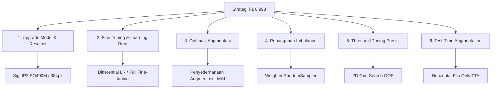

# Optimization Strategy: Achieving 0.998 F1-Macro on Waste Sorting

Dokumen ini menganalisis performa model klasifikasi sampah saat ini (baseline OOF F1-Macro `0.9853` / Test F1-Macro `0.9830`) dan memetakan strategi konkret untuk mencapai target F1-Macro **0.998**.

---

## 1. Analisis Matematis Target F1-Macro 0.998

Dengan ukuran test set sebesar **1.458 citra** dan perkiraan distribusi kelas (berdasarkan proporsi training set):
- **Organic (~44%):** ~645 sampel
- **Recyclable (~38%):** ~554 sampel
- **Electronic (~18%):** ~259 sampel

Kita dapat menghitung toleransi kesalahan (jumlah maksimal salah prediksi) untuk menyentuh metrik **0.998**:

| Skenario Kesalahan | F1 Organic | F1 Recyclable | F1 Electronic | **F1 Macro** | Status Target |
| :--- | :---: | :---: | :---: | :---: | :---: |
| **0 Error** (Perfect) | 1.0000 | 1.0000 | 1.0000 | **1.0000** | Lolos |
| **1 Error** di Electronic | 0.9992 | 1.0000 | 0.9980 | **0.9990** | Lolos |
| **1 Error** di Organic / Recyclable | 0.9992 | 0.9991 | 1.0000 | **0.9994** | Lolos |
| **2 Error** di Electronic | 0.9984 | 1.0000 | 0.9961 | **0.9981** | Lolos |
| **3 Error** di Electronic | 0.9976 | 1.0000 | 0.9941 | **0.9972** | **Gagal** (< 0.998) |
| **4 Error** di Organic | 0.9969 | 0.9963 | 1.0000 | **0.9977** | **Gagal** (< 0.998) |

> [!IMPORTANT]
> **Batas Toleransi Kesalahan Sangat Ketat:**
> - Jika kesalahan terjadi pada kelas minoritas (**Electronic**), kita **hanya boleh melakukan maksimal 2 kesalahan** di seluruh test set.
> - Jika kesalahan terjadi pada kelas **Organic** atau **Recyclable**, kita **hanya boleh melakukan maksimal 3 kesalahan**.
> - Secara keseluruhan, untuk menyentuh F1-Macro 0.998, model harus mengklasifikasikan **minimal 1.455 dari 1.458 citra uji dengan benar**.

---

## 2. Peta Strategi Peningkatan Performa

Untuk bergeser dari tingkat akurasi saat ini (~25-30 error pada test set) menjadi $\le$ 2-3 error, berikut adalah 6 strategi yang bisa diskusikan dan terapkan:



### 1. Upgrade & Penyederhanaan Model Backbone (Model Pruning)
Saat ini, model default melatih **7 model** (termasuk beberapa resolusi SigLIP yang sama dan model Large). Ini memakan waktu sangat lama (**5+ jam untuk 3-fold**) dan redundan. 

Untuk meningkatkan efisiensi dan mengurangi waktu training hingga **>2x lebih cepat (estimasi ~2 jam saja)**, kita harus menyederhanakan ensemble menjadi **3 model terbaik dari 3 rumpun arsitektur berbeda (maksimal keanekaragaman fitur)**:
1. **Rumpun Vision Transformer (Image-Text Contrastive):** `vit_base_patch16_siglip_384` (atau `vit_base_patch16_siglip_256`). SigLIP adalah jawara tunggal dengan F1 `0.9874`. Cukup pilih satu resolusi terbaik (256px atau 384px), tidak perlu melatih versi 224px lagi karena redundan.
2. **Rumpun Hierarchical Transformer (Window Attention):** `swinv2_base_window12to16_192to256_22kft1k`. Menggunakan mekanisme window attention lokal yang sangat berbeda dengan ViT global, memberikan prediksi pelengkap yang bagus untuk di-ensemble.
3. **Rumpun CNN Modern:** `convnextv2_base`. Memberikan bias induktif spasial (convolutional) yang saling melengkapi dengan rumpun transformer. Kita tidak perlu `convnextv2_large` karena performanya di leaderboard (0.9720) terbukti di bawah versi base (0.9746) namun jauh lebih lambat.

> [!TIP]
> Dengan hanya melatih **3 model terpilih** ini, proses training akan jauh lebih cepat, stabil, dan menghindari overfitting dari perataan bobot ensemble yang terlalu banyak model serupa. Varian model terbesar seperti `vit_so400m_patch14_siglip_384` (400M params) dapat dipertimbangkan jika 3 model base ini sudah optimal dan kita ingin mencari peningkatan ekstra terakhir di akhir kompetisi.

### 2. Strategi Fine-Tuning (Differential Learning Rates)
Saat ini di [config.py](src/trash_classifier/config.py#L29-L37), model hanya meng-unfreeze **1-2 block terakhir** dari total 12+ block. Ini membatasi kemampuan model untuk menyesuaikan representasi fitur menengah dengan karakteristik unik sampah lokal Indonesia.
- **Rekomendasi:** Lakukan fine-tuning pada **seluruh backbone** (atau minimal setengah blok teratas, misal 6-8 blok terakhir) menggunakan **Differential Learning Rate**:
  - Head/Classifier LR: `1e-4` hingga `2e-4`
  - Backbone LR: `1e-5` atau `5e-6` (10x - 20x lebih kecil dari Head LR)
- Ini menjaga agar fitur representasi tingkat rendah (warna, garis) yang sudah sangat bagus dari pretraining tidak rusak, namun memberikan fleksibilitas pada lapisan tengah untuk beradaptasi secara optimal.

### 3. Penyederhanaan Data Augmentasi (Mild vs Heavy)
Di [transforms.py](src/trash_classifier/transforms.py#L28-L61), augmentasi saat ini sangat agresif:
- Penambahan noise sensor (`AddGaussianNoise` dengan p=0.3)
- Blur buatan (`GaussianBlur` dengan p=0.3)
- Penghapusan bagian gambar (`RandomErasing` dengan p=0.2)

> [!TIP]
> Karena dataset training dan test set diambil dari distribusi yang sangat mirip (dibuktikan dengan adanya 97 duplikat piksel), **augmentasi yang terlalu berat justru dapat menurunkan performa** pada citra uji yang bersih. Model dipaksa mempelajari gambar rusak (noisy/blurry) yang tidak pernah muncul di test set.
> - **Usulan:** Nonaktifkan `AddGaussianNoise`, `GaussianBlur`, dan `RandomErasing`. Cukup gunakan augmentasi geometris standar: `RandomResizedCrop` (skala 0.8 - 1.0), `RandomHorizontalFlip`, dan sedikit `ColorJitter` (brightness/contrast saja).

### 4. Penanganan Ketidakseimbangan Kelas (Weighted Sampler)
Saat ini, ketidakseimbangan kelas ditangani via `class_weights` di `CrossEntropyLoss`. Namun, memberi bobot pada loss function terkadang membuat gradient update tidak stabil karena batch acak didominasi oleh kelas mayoritas.
- **Rekomendasi:** Gunakan **`WeightedRandomSampler`** di PyTorch DataLoader saat training.
- Sampler ini memastikan setiap batch yang masuk ke model memiliki jumlah sampel yang seimbang secara statistik antar kelas (misal, rasio ~1:1:1 per batch), sehingga model mendapatkan sinyal yang stabil dari kelas **Electronic** di setiap langkah optimasi.

### 5. Presisi Threshold Tuning (Grid Search vs Nelder-Mead)
Di [ensemble.py](src/trash_classifier/ensemble.py#L61-L90), `ThresholdTuner` mencari pengali probabilitas optimal menggunakan optimasi **Nelder-Mead**.
- **Masalah:** Fungsi objektif (Macro-F1 dari `argmax`) bersifat diskrit/tangga (step-function). Algoritma berbasis gradien atau simplex seperti Nelder-Mead sangat mudah terjebak di local minima pertama karena gradien lokalnya selalu nol.
- **Rekomendasi:** Ganti dengan **2D Grid Search** terarah pada OOF probability:
  - Kunci multiplier kelas `0_Recyclable` = `1.0`.
  - Lakukan pencarian grid (misal, 100x100 titik dari rentang `0.5` s.d `2.0` dengan langkah `0.01`) untuk multiplier kelas `1_Electronic` ($m_1$) dan `2_Organic` ($m_2$).
  - Karena hanya ada 3 kelas, pencarian grid ini sangat cepat (~1-2 detik di CPU) dan **dijamin** menemukan global optimum mutlak pada OOF set.

### 6. Evaluasi Ulang Test-Time Augmentation (TTA)
Saat ini di [trainer.py](src/trash_classifier/trainer.py#L137-L146), TTA menggunakan kombinasi **Horizontal Flip** dan **Vertical Flip**.
- **Analisis:** Banyak objek sampah (botol, HP, buah) memiliki orientasi gravitasi alami (bagian atas dan bawah yang jelas). Melakukan **Vertical Flip TTA** memaksa model memproses gambar terbalik, yang dapat mengacaukan positional embeddings dari Vision Transformers.
- **Usulan:** Bandingkan performa antara **Horizontal-Flip Only TTA** vs kombinasi saat ini. Kemungkinan besar Horizontal-Flip Only TTA lebih stabil dan menghasilkan akurasi lebih tinggi.

---

## 6. Alternatif Arsitektur Lain yang Potensial (`timm`)

Jika kita ingin mengganti atau menambahkan variasi model ke dalam ensemble (dengan tetap menjaga kuantitas maksimal 3–4 model agar training tetap cepat), berikut adalah beberapa arsitektur *state-of-the-art* (SOTA) di `timm` yang memiliki karakteristik pelengkap (*complementary*) yang sangat kuat:

### 1. DINOv2 (Self-Supervised ViT dari Meta AI)
* **Nama Model (`timm`):** `vit_base_patch14_reg4_dinov2.lujo_in1k` (atau `vit_large_patch14_reg4_dinov2.lujo_in1k`)
* **Mengapa Sangat Bagus?** Berbeda dengan SigLIP yang dilatih dengan mencocokkan teks-gambar (semantik tinggi), DINOv2 dilatih secara *self-supervised* untuk mendeteksi kesamaan visual, bentuk, dan tekstur objek tanpa label teks.
* **Keunikan:** Sangat unggul dalam membedakan detail geometri dan struktur (misal, membedakan kertas karton datar vs gelas kaca transparan). Ini melengkapi kelemahan SigLIP yang kadang terlalu berfokus pada "makna" kata dibanding detail piksel nyata.

### 2. MaxViT / CoAtNet (Hybrid Convolution-Attention dari Google)
* **Nama Model (`timm`):** `maxvit_base_tf_384` (atau `coatnet_2_rw_224`)
* **Mengapa Sangat Bagus?** Menggabungkan blok konvolusi lokal (CNN) dengan perhatian global (*global block/grid attention*).
* **Keunikan:** Memiliki efisiensi spasial yang luar biasa dan sangat peka terhadap variasi tekstur skala kecil (sangat berguna untuk kelas **Organic** seperti dedaunan, sisa sayuran, dan jamur yang tidak memiliki bentuk geometris tetap).

### 3. InternImage (Deformable Convolutional Network V3)
* **Nama Model (`timm`):** `internimage_b_1k_224`
* **Mengapa Sangat Bagus?** Menggunakan mekanisme *deformable convolution* di mana bentuk filter konvolusi dapat beradaptasi secara dinamis mengikuti bentuk objek di foto.
* **Keunikan:** Sampah sering kali ditemukan dalam bentuk penyok, remuk, atau robek (misal kaleng gepeng, botol plastik penyok, kardus sobek). Konvolusi konvensional atau ViT dengan patch kaku (persegi) kadang kesulitan mengenali objek terdistorsi ini. InternImage sangat fleksibel dalam mengenali objek yang mengalami deformasi fisik.

---

## 7. Rencana Eksperimen Terstruktur

Untuk mengeksekusi strategi di atas tanpa mengganggu training yang sedang berjalan, kita bisa merancang tahapan eksperimen sebagai berikut:

```
                      [Baseline OOF F1: 0.9853]
                                  │
                                  ▼
             [Eksperimen 1: Penyederhanaan 3 Model & 5-Fold]
              (Pilihan: SigLIP2 + Swin-B + ConvNeXt-B/DINOv2)
                                  │
                                  ▼
                   [Eksperimen 2: Mild Augmentation]
                                  │
                                  ▼
                [Eksperimen 3: WeightedRandomSampler]
                                  │
                                  ▼
                [Eksperimen 4: 2D Grid Search Tuning]
                                  │
                                  ▼
                      [Target F1: 0.9980+]
```

### Panduan Diskusi & Keputusan Tim:
1. **Model Terbesar:** Apakah kapasitas VRAM RTX 3060 (12GB) mencukupi untuk melatih `vit_so400m_patch14_siglip_384` dengan batch size 8 atau 16 (menggunakan mixed precision)?
2. **Post-Processing Leakage:** Apakah tim tetap sepakat 100% untuk menolak manual override test leakage (97 gambar) untuk menjaga kepatuhan etis scientific protocol secara mutlak? (Rekomendasi: Ya, karena model yang kuat akan menghafal dan memprediksinya dengan benar secara alami).
3. **Pilihan K-Fold:** Apakah tim setuju untuk bermigrasi sepenuhnya ke **5-Fold SKF** dengan **3 model terpilih** setelah run 7 model selesai?
4. **Eksplorasi Model Baru:** Apakah tertarik untuk menyuntikkan model alternatif seperti **DINOv2** atau **InternImage** untuk menggantikan ConvNeXt/Swin guna menangani objek deformasi/tekstur?
